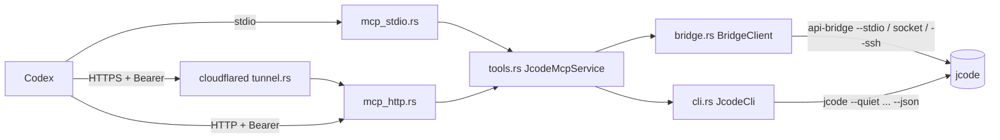

# jcode-rpc-for-codex

Rust RPC client library and MCP server (`stdio` + Streamable HTTP + Cloudflare Tunnel) for operating local or remote [`jcode`](https://github.com/1jehuang/jcode) workspaces from Codex.

## Highlights

- **Native `jcode api-bridge` v1 Multiplexed Client**: Concurrent request multiplexing by `id` / `reply_to` and per-session streaming event aggregation (`SessionEventBuffer`).
- **Non-Interactive CLI Wrapper**: Wraps `jcode version`, `auth status`, `provider current`, `model list`, `server start|stop|reload`, and `run --json`.
- **6 Orthogonal MCP Tools**: `jcode_run`, `jcode_session_prompt`, `jcode_session_manage`, `jcode_runtime_command`, `jcode_status`, and `jcode_workspace_file`.
- **4 Transport & Deployment Modes**: Local `stdio`, Streamable HTTP (`POST /mcp`, `/mcp/<token>`, built-in OAuth 2.0, `GET /healthz`), SSH remote forwarding, and Cloudflare Tunnel (`cloudflared` Quick or Named Tunnels).

## Architecture



## Quick Start

### 1. Install or Uninstall

**Option A: Homebrew (macOS & Linux):**

```bash
brew install bridge-for-codex/tap/jcode-mcp

# Uninstall:
brew uninstall jcode-mcp
```

**Option B: One-line script (macOS & Linux, no Rust required):**

```bash
curl -fsSL https://raw.githubusercontent.com/bridge-for-codex/jcode-rpc-for-codex/main/install.sh | sh

# Uninstall:
curl -fsSL https://raw.githubusercontent.com/bridge-for-codex/jcode-rpc-for-codex/main/install.sh | sh -s -- --uninstall
```

**Option C: Build from source with Cargo:**

```bash
cargo install --path .
jcode-mcp doctor
```

### 2. Configure in Codex (`~/.codex/config.toml`)

**Local `stdio` mode:**

```toml
[mcp_servers.jcode]
command = "/path/to/jcode-mcp"
args = ["stdio"]
```

**Remote HTTPS via Cloudflare Tunnel:**

```bash
jcode-mcp tunnel
```

Paste the `codex_config_toml` snippet printed by `jcode-mcp tunnel` into `~/.codex/config.toml`.
For **ChatGPT Web** connectors:
- **No Authentication mode**: Paste `public_mcp_token_url` (`https://<host>/mcp/<token>`).
- **OAuth mode**: Paste `public_mcp_url` (`https://<host>/mcp`) and authorize with your `bearer_token`.

## Documentation

- [**Configuration & Connection Modes (`docs/configuration.md`)**](docs/configuration.md): Global CLI flags, environment variables, `stdio`, Streamable HTTP, SSH forwarding, and Cloudflare Quick/Named Tunnels.
- [**MCP Tools & Response Streaming (`docs/mcp-tools.md`)**](docs/mcp-tools.md): Detailed reference for all 6 MCP tools, `TurnExecutionSummary` schema, synchronous (`wait=true`) vs. asynchronous polling (`wait=false` + `poll`), and mid-turn interrupts.
- [**Security & Workspace Boundaries (`docs/security.md`)**](docs/security.md): Bearer Token authentication, `--allow-cwd` workspace root validation, why `--allow-cwd` is not an OS sandbox (`bash` escape considerations), and hardening practices.

## License

[MIT](LICENSE)
