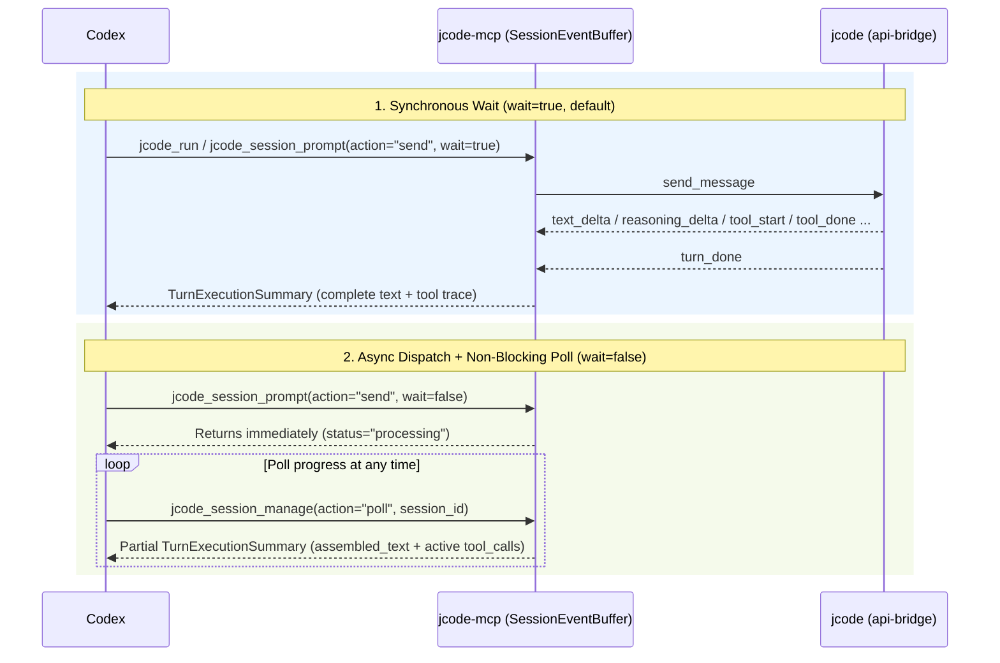

# MCP Tools & Response Streaming Reference

`jcode-mcp` exposes 6 MCP tools to Codex. Conversation turns and file inspections run over a multiplexed `jcode api-bridge` connection (`BridgeClient`), while one-shot CLI commands and daemon lifecycle controls use `JcodeCli`.

## Tool Catalog Overview

| Tool | Primary Purpose | Read-Only |
| :--- | :--- | :--- |
| `jcode_run` | Run a task or prompt in any `cwd` (persistent `bridge` session or one-shot `cli`). | No |
| `jcode_session_prompt` | Send prompts, mid-turn `soft_interrupt`, or turn control (`cancel`, `clear`, `compact`, `rewind`, `rewind_undo`). | No |
| `jcode_session_manage` | Manage sessions (`list`, `create`, `attach`, `detach`, `peek`, `rename`, `archive`, `restore`, `fork`, `history`, `todos`, `tools`, `poll`). | No |
| `jcode_runtime_command` | Switch model (`set_model`), reasoning effort (`set_effort`), list models (`models`), or run runtime commands. | No |
| `jcode_status` | Check runtime health (`overview`, `version`, `auth`, `provider`, `models`, `runtime_info`) or control the daemon (`daemon_start`, `daemon_stop`, `daemon_reload`). | No |
| `jcode_workspace_file` | Fast token-free workspace file inspection (`find`, `read` with line slicing, `search`, `status`). | Yes |

---

## How Responses Are Collected (`TurnExecutionSummary`)

When Codex sends a prompt to `jcode` via `jcode_run` (`mode: "bridge"`) or `jcode_session_prompt` (`action: "send"`), `SessionEventBuffer` ingests the real-time JSONLines event stream from `jcode api-bridge` (`text_delta`, `text_replace`, `reasoning_delta`, `tool_start`, `tool_done`, `token_usage`, `turn_done`, `turn_stopped`) and returns a structured `TurnExecutionSummary`:

```json
{
  "session_id": "session_otter_1793864719626_85e2eac3397b68d7",
  "assembled_text": "All tests pass and the refactor is complete.",
  "reasoning_text": "Checking Cargo.toml and running cargo test...",
  "status": "idle",
  "stop_reason": null,
  "tool_calls": [
    {
      "call_id": "call_1",
      "name": "bash",
      "input": { "command": "cargo test" },
      "output": "test result: ok. 6 passed; 0 failed",
      "done": true
    }
  ],
  "usage": {
    "input_tokens": 1240,
    "output_tokens": 310
  },
  "events_observed": 18
}
```

### Three Ways to Retrieve Results



1. **Synchronous Wait (`wait: true`, default)**:
   - Blocks until `turn_done` or `turn_stopped` (or `timeout_secs`, returning `status: "timeout_in_progress"` with partial output).
2. **Asynchronous Dispatch + Polling (`wait: false` + `poll`)**:
   - Pass `wait: false` to `jcode_session_prompt(action="send")` to return immediately while `jcode` works in the background.
   - Call `jcode_session_manage(action="poll", session_id="...")` at any time to inspect the partial `assembled_text`, `reasoning_text`, `tool_calls`, and `status` (`"processing"` vs `"idle"`).
   - While a turn is running, you can also inject guidance via `jcode_session_prompt(action="soft_interrupt", session_id="...", prompt="...", urgent=true)`.
3. **Persisted Session Inspection (`peek`, `history`, `todos`)**:
   - Even across reconnects, call `jcode_session_manage` with `action: "peek"` (recent messages), `action: "history"` (full transcript), or `action: "todos"` (current todo list and goal assessments).

---

## Tool Parameter Reference

### 1. `jcode_run`
- `prompt` *(string, required)*: Task instructions for `jcode`.
- `cwd` *(string, optional)*: Workspace directory (resolved and validated against `--allow-cwd`).
- `mode` *(`"bridge"` | `"cli"`, default `"bridge"`)*: `"bridge"` creates/reuses an `api-bridge` session; `"cli"` runs `jcode run --json`.
- `session_id` *(string, optional)*: Existing session ID to reuse.
- `model` / `provider` *(string, optional)*: Model or provider override.
- `system_prompt` *(string, optional)*: Custom system prompt when creating a bridge session.
- `timeout_secs` *(integer, default `300`)*: Execution timeout in seconds (`5..=3600`).

### 2. `jcode_session_prompt`
- `session_id` *(string, required)*: Target session ID.
- `action` *(`"send"` | `"soft_interrupt"` | `"cancel"` | `"clear"` | `"compact"` | `"rewind"` | `"rewind_undo"`, default `"send"`)*.
- `prompt` *(string)*: Required for `send` and `soft_interrupt`.
- `system_reminder` *(string, optional)*: Per-turn system reminder for `send`.
- `urgent` *(boolean, default `false`)*: Immediate interrupt flag for `soft_interrupt`.
- `wait` *(boolean, default `true`)*: Wait for turn completion on `send`.
- `timeout_secs` *(integer, default `300`)*: Timeout when `wait=true`.
- `message_index` *(integer, optional)*: Target message index when `action="rewind"`.

### 3. `jcode_session_manage`
- `action` *(`"list"` | `"create"` | `"attach"` | `"detach"` | `"peek"` | `"rename"` | `"archive"` | `"restore"` | `"fork"` | `"history"` | `"todos"` | `"tools"` | `"poll"`, required)*.
- `session_id` *(string)*: Required for all actions except `list` and `create`.
- `cwd` *(string, optional)*: Workspace directory for `create`.
- `title` *(string, optional)*: New title for `rename`.
- `system_prompt` *(string, optional)*: Custom system prompt for `create`.
- `archive_after_days` *(integer, optional)*: Auto-archive retention days for `create`.
- `include_archived` *(boolean, default `false`)*: Include archived sessions in `list`.
- `limit` *(integer, optional)*: Max messages to return in `peek`.

### 4. `jcode_runtime_command`
- `command` *(string, required)*: `"models"`, `"set_model"`, `"set_effort"`, or any `jcode` runtime command.
- `args` *(array of strings, default `[]`)*: Command arguments (e.g., `["gpt-5.4"]` for `set_model`, `["high"]` for `set_effort`).
- `session_id` / `cwd` *(string, optional)*: Session scope or workspace directory.

### 5. `jcode_status`
- `action` *(`"overview"` | `"version"` | `"auth"` | `"provider"` | `"models"` | `"runtime_info"` | `"daemon_start"` | `"daemon_stop"` | `"daemon_reload"`, default `"overview"`)*.
- `cwd` / `provider` / `session_id` *(string, optional)*.

### 6. `jcode_workspace_file`
- `action` *(`"find"` | `"read"` | `"search"` | `"status"`, required)*.
- `session_id` / `cwd` *(string, optional)*: Target session or workspace directory.
- `query` *(string)*: Search query for `find` or `search`.
- `path` *(string)*: File or directory path for `read`, `search`, or `status`.
- `start_line` / `end_line` *(integer, optional)*: 1-based inclusive line range for `read`.
- `max_bytes` *(integer, optional)*: Maximum bytes to read for `read`.
- `limit` *(integer, default `50`)*: Maximum results for `find` or `search`.
